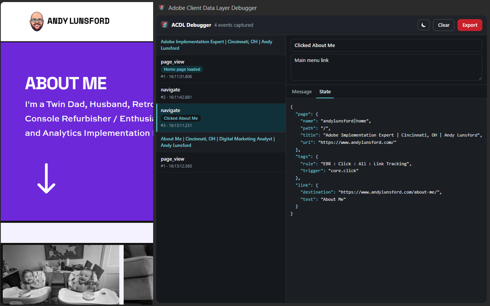

# Adobe Client Data Layer Debugger

A Manifest V3 browser extension for **Chrome, Firefox and Safari** that passively captures every push to `window.adobeDataLayer`, deep-clones the full `getState()` snapshot per push, surfaces the timeline in a panel (Chrome **Side Panel**, Firefox **Sidebar**, Safari toolbar **popup**), and exports it as a self-describing JSON file for post-recording debugging.

Built for debugging ACDL-instrumented sites.



## Features

- Captures every `adobeDataLayer.push(...)` with a deep-cloned state snapshot per event
- Replays events pushed before the extension loaded (`scope: 'all'`)
- Per-tab timeline — list + detail view
- One-click **Clear** and **Export** (downloads a documented JSON envelope)
- Survives MV3 background eviction via `storage.session`
- Zero runtime dependencies — vanilla JS + CSS

## Prerequisites

- **Google Chrome 120+** (or any Chromium browser with Side Panel support)
- **Firefox 142+** (desktop only — Firefox for Android has no sidebar)
- **Safari 17.5+** on macOS, plus **Xcode** to wrap the extension in the app Safari requires
- To build from source: **Node.js 22.12+** and npm (CI uses Node 22 — see `.nvmrc`)

## Install (from a release)

Each [release](https://github.com/andylunsford/adobe-client-data-layer-debugger/releases/latest) attaches one zip per browser (`acdl-debugger-vX.Y.Z-chrome.zip`, `-firefox.zip`, `-safari.zip`) plus, once AMO signing is set up, a Mozilla-signed `acdl-debugger-vX.Y.Z-firefox.xpi`.

### Chrome

1. Download the `-chrome.zip` and unzip it
2. Open `chrome://extensions` and enable **Developer mode** (top-right toggle)
3. Click **Load unpacked** and select the unzipped folder

To update, replace that folder's contents with the newer release and click the reload icon on the extension's card.

### Firefox

- **Install (signed):** download the release's `-firefox.xpi` and open it in Firefox 142+ (or drag it onto a Firefox window). It stays installed across restarts. Mozilla signs it as *unlisted*: it is not on addons.mozilla.org and won't auto-update, so install each new release's `.xpi` the same way.
- **Try it unsigned:** open `about:debugging#/runtime/this-firefox`, click **Load Temporary Add-on**, and pick the `-firefox.zip` (or `dist/firefox/manifest.json`). Temporary add-ons are removed when Firefox restarts.
- **Publish:** upload the `-firefox.zip` at [addons.mozilla.org/developers](https://addons.mozilla.org/developers/). Because the bundles are generated by esbuild, AMO also asks for the source code; upload the release's source archive and point reviewers at `npm ci && npm run build` (output in `dist/firefox`). For a self-distributed signed `.xpi`, submit it as "On your own" instead of "On this site".
- Click the toolbar button (or **View → Sidebar**) to open the sidebar.

The add-on ID is `developer@acdl-debugger.com` (`src/lib/target-manifest.js`). AMO ties the add-on to it permanently once the first version is signed.

### Safari

Safari only runs web extensions that ship inside a native macOS app, so the zip is the input to Apple's converter, not something you install directly. On a Mac with Xcode:

```bash
unzip acdl-debugger-vX.Y.Z-safari.zip -d acdl-safari   # or use dist/safari from a local build
xcrun safari-web-extension-converter acdl-safari --macos-only --app-name "ACDL Debugger" --bundle-identifier com.example.acdl-debugger
```

Build and run the generated Xcode project, then enable the extension in **Safari → Settings → Extensions**. To load an unsigned build, first turn on **Develop → Developer Settings → Allow unsigned extensions** (resets each time Safari quits). Grant the extension access to the sites you debug when Safari asks. Distributing to other Macs requires an Apple Developer account (App Store or notarized app).

Safari has no side panel or sidebar API, so the panel opens as a toolbar **popup** and closes when you click back into the page. Capture keeps running in the background; reopen the popup to see new events. Safari has no `downloads` API, so **Export** saves through a regular download link.

## Install (from source, unpacked)

```bash
npm install
npm run icons    # regenerate icons from assets/icon-source.png (already committed)
npm run build    # produces dist/chrome, dist/firefox, dist/safari
```

Then load it into Chrome:

1. Open `chrome://extensions`
2. Enable **Developer mode** (top-right toggle)
3. Click **Load unpacked** and select the `dist/chrome` directory
4. Open any page and click the **Adobe Data Layer Debugger** toolbar action to open the Side Panel

For Firefox and Safari, use `dist/firefox` / `dist/safari` as described above.

The panel always reflects the **active** tab. Switching tabs re-subscribes automatically.

### Quick verification

- **Has ACDL** — visit a site that uses `window.adobeDataLayer`; events appear in the panel.
- **No ACDL** — visit `https://example.com/`; the panel shows a "not detected" banner.
- **Trim test** — in the page console: `for (let i = 0; i < 6000; i++) adobeDataLayer.push({ event: 'load.test', n: i })` — the store FIFO-trims at 5000.

## Contributing / building

All non-trivial logic lives in `src/lib/` as pure modules (no extension APIs) so it can be unit-tested in Node. The four entry files — `inject.js`, `content.js`, `background.js`, `sidepanel/sidepanel.js` — are the only places that touch extension APIs / `window.*`. They use `ext` from `src/ext.js` (`browser` in Firefox/Safari, `chrome` in Chrome) rather than `chrome.*` directly.

`manifest.json` is the Chrome manifest; `src/lib/target-manifest.js` derives the Firefox and Safari manifests from it at build time.

```bash
npm install          # install dev dependencies (esbuild, vitest, jsdom, sharp)
npm test             # run unit tests (84 tests: 9 lib modules + the store scripts)
npm run test:watch   # re-run tests on change
npm run test:e2e     # build, then run real-browser tests in headless Chromium + Firefox
npm run build        # one-off bundle into dist/<chrome|firefox|safari>
npm run build -- --target=firefox   # build a single target
npm run build:watch  # rebuild dist/chrome on change (add -- --target=firefox for Firefox)
npm run icons        # regenerate icons/ from assets/icon-source.png
```

**Conventions:**

- **TDD** — write a failing test under `tests/` before adding behavior to a `src/lib/` module.
- **No runtime framework** — vanilla JS + CSS for the side panel.
- **`inject.js` must be self-contained** — it runs in the page MAIN world and cannot `import`. esbuild emits IIFE bundles targeting `chrome120` / `firefox142` / `safari17`.
- **Minimize comments** — prefer self-documenting code.

After editing, run `npm run build` and reload the extension (`chrome://extensions`, or **Reload** in `about:debugging` for Firefox).

CI (`.github/workflows/ci.yml`) runs the tests, builds all three targets, runs Mozilla's `web-ext lint` (the AMO validator) on the Firefox build, and runs the e2e suite in Chromium and Firefox on every push to `main` and every pull request.

**E2E tests** (`tests/e2e/`) load the built extension into headless Chromium (Playwright) and Firefox (puppeteer-core over WebDriver BiDi), serve a local page running the real ACDL library, and check that captures, state snapshots, navigation, strict-CSP pages, the panel's event list and Clear all work. Chromium comes from `npx playwright install chromium`. Firefox must be installed on the machine; set `FIREFOX_BIN` if it isn't on `PATH`. Safari isn't covered: it only runs on macOS.

## Releasing

Releases are built and published by GitHub Actions (`.github/workflows/release.yml`) when a version tag is pushed:

```bash
npm version minor -m "chore: release v%s"   # or patch / major — bumps package.json + manifest.json, commits, tags
git push --follow-tags                      # pushes the commit and tag; the workflow publishes the release
```

The workflow checks that the tag matches the version in `package.json` and `manifest.json`, runs the tests, builds, and attaches `acdl-debugger-vX.Y.Z-{chrome,firefox,safari}.zip` to a new GitHub release. It then has Mozilla sign the Firefox build on the unlisted AMO channel (uploading `git archive` of the tag as the source code) and attaches the signed `-firefox.xpi`. Signing usually takes minutes; the step waits up to 20 minutes. If it times out, the release keeps its zips and the signed file can be downloaded from the AMO Developer Hub and attached by hand. AMO accepts each version only once, so a failed signing run can't simply be re-run; bump the version instead.

**One-time setup for signing:** create API credentials at [addons.mozilla.org/developers/addon/api/key](https://addons.mozilla.org/developers/addon/api/key/), then add them as repository secrets `AMO_JWT_ISSUER` and `AMO_JWT_SECRET` (**Settings → Secrets and variables → Actions**). Without them, releases still publish and the job logs a warning that no `.xpi` was signed. The first signed upload registers the add-on ID `developer@acdl-debugger.com` to your AMO account permanently.

In parallel, the workflow submits the release's `-chrome.zip` to the Chrome Web Store (`scripts/chrome-web-store.mjs`, Chrome Web Store API v2). Google reviews it and publishes automatically once approved, using the visibility set in the dashboard. The store requires a higher `version` than the last upload, which the tag check already enforces. Stable Chrome only installs extensions from the store (or by enterprise policy), so the `-chrome.zip` on the release is for **Load unpacked**.

**One-time setup for Chrome Web Store publishing:**

1. In the [Google Cloud console](https://console.cloud.google.com/), pick or create a project, enable the **Chrome Web Store API**, and create a service account (it needs no IAM roles). Create a **JSON key** for it.
2. In the [Chrome Web Store Developer Dashboard](https://chrome.google.com/webstore/devconsole), add the service account's email under **Account** (one service account per publisher). 2-step verification must be on for your Google account.
3. In the repo's **Settings → Secrets and variables → Actions**, add the secret `CWS_SERVICE_ACCOUNT_KEY` (the whole JSON key file) and the variables `CWS_PUBLISHER_ID` (Dashboard → Publisher → Settings) and `CWS_EXTENSION_ID` (the item ID in the store URL).

Without them the job logs a warning and skips. Publishing to the App Store is manual.

To check all store credentials without releasing, run **Actions → Validate store credentials → Run workflow**. It is read-only: it loads your AMO profile and looks up the add-on ID, then gets a Chrome Web Store token and reads the item's status. Nothing is uploaded or submitted.

## Architecture

```
Page MAIN world           Isolated world         Extension
─────────────────         ──────────────         ─────────
inject.js          ──▶    content.js      ──▶   background.js  ◀──▶  sidepanel/
(hooks ACDL,             (bridge:               (service worker:      (UI: list,
 deep-clones state,       window.postMessage     per-tab store +       detail,
 posts events)            → chrome.runtime)      session storage       Clear/Export)
                                                 persistence)
```

ACDL lives on `window` and is invisible to isolated-world content scripts, so a page-world script (`inject.js`) hooks it via its documented `addEventListener` API. The isolated-world `content.js` bridges page messages to `chrome.runtime`. The service worker owns the canonical `Map<tabId, capture>` and persists to `chrome.storage.session` to survive MV3 eviction.

See `CLAUDE.md` for the full architecture notes, file layout, and known gotchas.

## Project layout

```
manifest.json            # MV3 manifest for Chrome (Firefox/Safari variants derived at build)
build.mjs                # esbuild bundle script
vitest.config.js         # unit test config (vitest.e2e.config.js for e2e)
.github/workflows/       # CI (test + build) and tag-driven releases
scripts/                 # icon generation + release version helpers
assets/icon-source.png   # source artwork (not shipped in dist/)
src/
  inject.js              # page-world entry (self-contained IIFE)
  content.js             # isolated-world bridge
  background.js          # service worker (event page in Firefox)
  ext.js                 # browser/chrome namespace shim
  lib/                   # pure, unit-tested modules
  sidepanel/             # panel UI (html/js/css): side panel / sidebar / popup
tests/                   # vitest, one file per lib module; e2e/ = real-browser tests
icons/                   # generated by `npm run icons` (committed)
dist/<target>/           # build output per browser — load unpacked (git-ignored)
```

## License

Copyright 2026 Andy Lunsford. Licensed under the [Apache License, Version 2.0](LICENSE).
